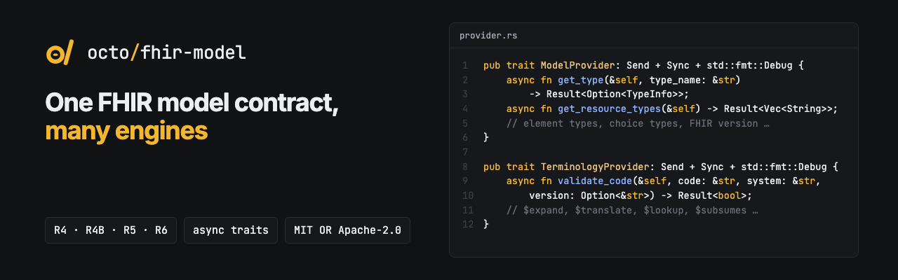

<p align="center"></p>

<p align="center"><b>The shared async traits FHIRPath engines, validators and servers use to talk about FHIR types, terminology and data.</b></p>

<p align="center">
  <a href="https://github.com/octofhir/fhir-model-rs/actions/workflows/ci.yml"></a>
  <a href="https://crates.io/crates/octofhir-fhir-model"></a>
  <a href="https://docs.rs/octofhir-fhir-model"></a>
  <a href="#license"></a>
</p>

Core FHIR model abstractions and ModelProvider trait for FHIRPath type-aware evaluation.

## Overview

This crate provides the foundational types and traits for FHIR model integration with FHIRPath engines. It serves as an intermediate dependency to break circular dependencies between FHIRPath implementations and FHIR schema libraries.

## Architecture

The crate defines a small set of `async` traits (via `async-trait`) that concrete
implementations plug into:

- **`ModelProvider`** - FHIR type information: `get_type`, `get_element_type`,
  `get_elements`, choice and union types, resource/complex/primitive type lists and the
  FHIR version. `EmptyModelProvider` and `LiteModelProvider` are included;
  [octofhir-fhirschema](https://crates.io/crates/octofhir-fhirschema) provides
  schema-backed implementations.
- **`TerminologyProvider`** - `validate_code`, `expand_valueset`, `translate_code`,
  `lookup_code`, `subsumes` and friends. `NoOpTerminologyProvider` is included;
  `HttpTerminologyProvider` and `CachedTerminologyProvider` sit behind features.
- **`FhirPathEvaluator` / `ValidationProvider`** - hooks for constraint evaluation and
  profile conformance checks.
- **`ServerProvider`** - `read`, `create`, `update` and related calls against a FHIR
  server (`NoOpServerProvider`, and `HttpServerProvider` behind `http-client`).

## Features

- `default` - enables `serde`
- `serde` - serialization support via `serde`
- `http-client` - `HttpTerminologyProvider` and `HttpServerProvider` (via `reqwest`)
- `caching` - `CachedTerminologyProvider` (via `moka`); `DefaultTerminologyProvider`
  needs both `http-client` and `caching`

## Installation

Add this to your `Cargo.toml`:

```toml
[dependencies]
octofhir-fhir-model = "0.1"
```

With the HTTP terminology/server clients and caching:

```toml
[dependencies]
octofhir-fhir-model = { version = "0.1", features = ["http-client", "caching"] }
```

## Usage

### Inspecting types through a ModelProvider

```rust
use octofhir_fhir_model::{ModelProvider, Result};

async fn inspect_type(provider: &dyn ModelProvider, type_name: &str) -> Result<()> {
    if let Some(type_info) = provider.get_type(type_name).await? {
        println!("Type: {}", type_info.type_name);
    }

    for element in provider.get_elements(type_name).await? {
        println!("  Element: {} ({})", element.name, element.element_type);
    }

    println!("FHIR version: {:?}", provider.get_fhir_version().await?);
    Ok(())
}
```

## Modules

- **`error`** - Error types and result handling
- **`evaluation`** - Evaluation result values and conversions
- **`evaluator`** - `FhirPathEvaluator`, `ValidationProvider` and constraint types
- **`fhir_traits`** - Traits for FHIR primitives, references, choice and backbone elements
- **`prepared`** - Prepared resources and executable expressions
- **`provider`** - Core `ModelProvider` trait, `TypeInfo`, `ElementInfo`, `FhirVersion`
- **`server`** - `ServerProvider` trait and implementations
- **`terminology`** - `TerminologyProvider` trait, result types and implementations

## FHIR Version Support

This crate is designed to work with multiple FHIR versions through the `FhirVersion` enum:

- FHIR R4 (4.0.x)
- FHIR R4B (4.3.x)
- FHIR R5 (5.0.x)
- FHIR R6 (6.0.x)
- `Custom { version }` for anything else

## Development

### Prerequisites

- Rust 2024 edition or later
- [just](https://github.com/casey/just) command runner (optional, for convenience)

### Building

```bash
cargo build
```

Or using just:

```bash
just build
```

### Testing

```bash
cargo test --all-features
```

Or using just:

```bash
just test-all
```

### Documentation

Generate and open documentation:

```bash
cargo doc --no-deps --all-features --open
```

Or using just:

```bash
just doc-open
```

## Contributing

Contributions are welcome! Please feel free to submit a Pull Request.

### Development Workflow

1. Fork the repository
2. Create a feature branch
3. Make your changes
4. Run the test suite: `just test-all`
5. Run formatting and linting: `just fmt` and `just lint`
6. Submit a pull request

## License

This project is dual-licensed under either:

- **MIT License** ([LICENSE-MIT](LICENSE-MIT) or http://opensource.org/licenses/MIT)
- **Apache License, Version 2.0** ([LICENSE-APACHE](LICENSE-APACHE) or http://www.apache.org/licenses/LICENSE-2.0)

at your option.

### Contribution

Unless you explicitly state otherwise, any contribution intentionally submitted for inclusion in the work by you, as defined in the Apache-2.0 license, shall be dual licensed as above, without any additional terms or conditions.

## Acknowledgments

This project is part of the [OctoFHIR](https://github.com/octofhir) ecosystem for FHIR processing in Rust.
